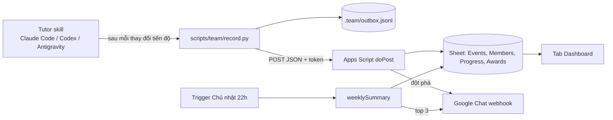

# Theo dõi tiến độ học chứng chỉ Claude cho team

Mỗi member học bằng tutor `claude-certification` trên bản clone của mình. Sau mỗi thay đổi tiến độ, tutor gọi `scripts/team/record.py`. Script gửi một event lên Apps Script web app. Web app ghi vào Google Sheet, gửi lời khen "đột phá" lên Google Chat, và tổng kết tuần vào tối Chủ nhật. Hệ thống chỉ khen, không nhắc nhở.



Bản clone chưa tham gia team vẫn học bình thường: `record.py` in một dòng rồi thoát 0.

## Dành cho member

### 1. Tham gia team (một lần)

Copy lệnh admin ghim trong space Chat rồi chạy ở thư mục gốc repo:

```bash
python3 scripts/team/setup.py --join <mã>
```

Script hỏi 3 câu:

1. **Email công ty**: gõ phần trước `@vti.com.vn`, ví dụ `an.nguyen`. Gõ đủ địa chỉ cũng được, miễn đúng đuôi `@vti.com.vn`.
2. **Tên hiển thị trên Chat**: mặc định là phần trước `@`. Nên gõ tên thật, ví dụ `Nguyễn Văn An`.
3. **Chia sẻ điểm**: mặc định bật.

Cấu hình nằm trong `.team/config.json`. Git bỏ qua file này vì nó chứa token chung của team. Không gửi file này cho ai.

Muốn đổi tên hoặc email thì chạy lại `--join` với cùng mã. Các câu trả lời cũ là giá trị mặc định.

### 2. Học với tutor

| Harness | Cách bắt đầu |
|---|---|
| Claude Code | Mở repo, gõ `/claude-certification` |
| Codex | Mở repo, gõ `Start my Claude certification`. `AGENTS.md` trỏ Codex tới `skills/claude-certification/SKILL.md` |
| Antigravity | Thử như Codex. Nếu Agent không nhận skill, dán prompt bên dưới |

```text
Read skills/claude-certification/SKILL.md completely. Use it to choose my
Claude certification track, create my learning plan, and teach me one lesson
at a time with the real labs, artifacts, quizzes, and remediation in this repo.
```

Không cài skill bằng `npx skills add` từ repo gốc. Bản đó không có bước ghi tiến độ team. Hãy dùng skill trong chính bản clone này.

Mỗi người chỉ học 1 track tại một thời điểm. Tutor tự gọi `record.py` ở các bước sau:

| Lúc | Lệnh tutor chạy |
|---|---|
| Chốt hoặc đổi track | `record.py track-start` |
| Một bài chuyển sang `Complete` | `record.py lesson-complete` |
| Làm xong diagnostic hoặc mock | `record.py assessment` |
| Kết thúc buổi học | `record.py flush` |

Bài chỉ được tính khi tutor đánh dấu `Complete`. Trạng thái `Theory complete, lab pending` chưa được tính.

### 3. Bật hoặc tắt chia sẻ điểm

```bash
python3 scripts/team/setup.py --share off
python3 scripts/team/setup.py --share on
```

Lựa chọn này chỉ ảnh hưởng **điểm số** (quiz, mock) trên Dashboard và Chat. **Tiến độ luôn công khai, có tên.** Khi tắt share mà đạt mock ≥80%, Chat vẫn khen nhưng giấu tên.

Admin vẫn xem được điểm của mọi người trong tab `Events`.

### 4. Khi mất mạng

Mỗi event được ghi vào `.team/outbox.jsonl` trước rồi mới gửi. Mất mạng thì event nằm chờ ở đó, buổi học không bị gián đoạn. Lần ghi sau, hoặc khi chạy lệnh dưới, script gửi tiếp theo đúng thứ tự:

```bash
python3 scripts/team/record.py flush
```

| Thông báo | Ý nghĩa |
|---|---|
| `chưa gửi được tiến độ (...)` | Lỗi mạng hoặc web app quá tải. Event vẫn chờ, không cần làm gì |
| `token team bị từ chối` | Admin đã đổi token. Lấy mã mới trong Chat rồi chạy lại `setup.py --join <mã>`. Event đang chờ sẽ được gửi bằng token mới |
| `máy chủ từ chối event ...` | Event sai định dạng. Event được chuyển sang `.team/rejected.jsonl`. Báo admin nếu thấy thông báo này |

### 5. Dữ liệu gửi đi

Mỗi event gồm: email, loại event, track, số bài của route, thời điểm, và dữ liệu riêng của loại event (đường dẫn bài và điểm post-quiz, hoặc điểm diagnostic/mock theo domain). Bài làm trong `learning-artifacts/` và file `CLAUDE-CERTIFICATION.md` không bao giờ rời khỏi máy.

## Dành cho admin

### 1. Chuẩn bị Sheet và Apps Script

1. Tạo một Google Sheet. Vào **File → Settings**, chọn time zone `(GMT+07:00) Bangkok, Hanoi, Jakarta`. Tab Dashboard dùng `TODAY()` theo time zone này.
2. Mở **Extensions → Apps Script**. Nếu đã có project dùng để test, mở lại đúng project đó.
3. Vào **Project Settings**, bật **Show "appsscript.json" manifest file in editor**.
4. Dán nội dung 3 file vào editor, mỗi file một tên:
   - `team/apps-script/Code.gs` vào `Code.gs`
   - `team/apps-script/Logic.gs` vào `Logic.gs`
   - `team/apps-script/appsscript.json` vào `appsscript.json`
5. Vào **Project Settings → Script Properties**, thêm:

| Property | Giá trị |
|---|---|
| `TEAM_TOKEN` | Chuỗi ngẫu nhiên, sinh bằng lệnh dưới bảng |
| `ALLOWED_DOMAIN` | `vti.com.vn` |
| `CHAT_WEBHOOK_URL` | Webhook của space Chat: **Apps & integrations → Webhooks → Add webhook** |
| `SHEET_ID` | Chỉ cần khi project Apps Script đứng riêng, không gắn với Sheet. Lấy từ URL của Sheet |

```bash
python3 -c "import secrets; print(secrets.token_urlsafe(24))"
```

Không đưa giá trị nào ở trên vào repo. Repo là public.

### 2. Khởi tạo và deploy

1. Trong editor, chọn hàm `setupSheets` rồi bấm **Run**. Lần đầu Google sẽ hỏi quyền. Hàm tạo các tab `Events`, `Members`, `Progress`, `Awards`, `Templates`, `Dashboard`. Chạy lại cũng không mất dữ liệu.
2. Chạy `testChat`. Space Chat phải nhận được một tin nhắn thử.
3. Deploy:
   - Lần đầu: **Deploy → New deployment → Web app**, Execute as **Me**, Who has access **Anyone**.
   - Các lần sau: **Deploy → Manage deployments**, bấm bút chì ở deployment đang dùng, chọn **Version: New version**, rồi **Deploy**. URL `/exec` giữ nguyên nên member không phải tham gia lại.
4. Chạy `installWeeklyTrigger` một lần. Trigger gọi `weeklySummary` vào Chủ nhật, trong khung 22h–23h theo time zone của project.
5. Kiểm tra web app, kết quả phải là `{"ok":true,...}`:

```bash
curl -sL "https://script.google.com/macros/s/<deployment-id>/exec"
```

### 3. Mời member

```bash
python3 scripts/team/setup.py --make-code
```

Script hỏi URL `/exec`, `TEAM_TOKEN` (gõ không hiện), domain (mặc định `vti.com.vn`), rồi in ra lệnh `setup.py --join <mã>`. Ghim lệnh đó trong space Chat. Mã chứa token, nên chỉ ghim trong space nội bộ.

Nên chạy thử toàn bộ với 1 member trước khi mời cả team.

### 4. Các tab trong Sheet

| Tab | Ai ghi | Nội dung |
|---|---|---|
| `Events` | `doPost`, chỉ thêm dòng | Mọi event, kể cả điểm số. Cột `payload` giữ nguyên event, trừ token |
| `Members` | `doPost` | email, tên, track hiện tại, share, ngày tham gia, hoạt động gần nhất |
| `Progress` | `doPost` tính lại | Mỗi cặp member × track: số bài **khác nhau** đã `Complete`, tổng, %, ngày bắt đầu, ngày xong |
| `Awards` | `doPost`, `weeklySummary` | Khoá của mỗi lời khen đã gửi, để không khen trùng |
| `Templates` | Admin sửa tay | Mẫu tin nhắn |
| `Dashboard` | Công thức | Mỗi dòng là một cặp member × track, xếp theo % giảm dần, kèm biểu đồ "% route theo từng người" |

Ai có quyền xem Sheet thì xem được mọi tab, kể cả điểm trong `Events`. Nếu chia sẻ Sheet cho cả team, hãy ẩn các tab dữ liệu và tắt quyền tải, in, sao chép của người xem. Lựa chọn share của member chỉ quyết định Dashboard và Chat có hiện điểm hay không.

Nếu Dashboard bị sửa hỏng, chạy `rebuildDashboard` để dựng lại.

### 5. Quy tắc khen

| Tình huống | Điều kiện | Khoá trong `Awards` | Hiện tên |
|---|---|---|---|
| `day3`: ngày năng suất | Chạm 3 bài mới `Complete` trong cùng một ngày (GMT+7). Event không trễ quá 24 giờ. Mỗi ngày khen tối đa 1 lần | `day3:<email>:<yyyy-mm-dd>` | Luôn hiện |
| `mock80`: mock ≥80% | Mock (không tính diagnostic) đạt ≥80%, lần đầu của mỗi track | `mock80:<email>:<track>` | Hiện khi bật share |
| `mock80_anon` | Như trên, khi member tắt share | `mock80:<email>:<track>` | Giấu tên |
| `first_finish`: về đích đầu tiên | Người đầu tiên xong toàn bộ route của một track | `first:<track>` | Luôn hiện |
| `finish`: về đích | Những người xong track sau người đầu tiên | `finish:<email>:<track>` | Luôn hiện |
| `weekly`: tổng kết tuần | Xem mục 6 | `weekly:<yyyy-mm-dd>:<email>` | Luôn hiện, không hiện điểm |

"Bài mới" là bài member xong lần đầu, tính trên mọi track. Khi đổi track, tutor ghi lại các bài chung đã xong. Các bài đó được cộng vào `Progress` của track mới nhưng không tính là bài mới.

### 6. Tổng kết tuần

- Cửa sổ tính từ lần chạy trước đến lúc chạy. Mốc lưu trong Script Property `LAST_WEEKLY_AT`, nên không sót event.
- Mức tăng của mỗi member = tổng theo track của (số bài mới nhận được trong cửa sổ / số bài của route) × 100.
- Bỏ người có mức tăng bằng 0. Xếp hạng đồng hạng (dense rank), lấy hạng 1–3, nên có thể nhiều hơn 3 người.
- Không ai tiến bộ thì không gửi tin.
- Gửi Chat thất bại thì mốc không đổi và hàm báo lỗi. Google sẽ gửi email báo lỗi trigger cho admin. Sửa xong thì chạy lại `weeklySummary` bằng tay.
- Event đến muộn từ outbox sau khi tổng kết đã chạy vẫn vào `Progress`, và được tính vào tuần kế tiếp.

### 7. Sửa mẫu tin nhắn

Mỗi dòng trong tab `Templates` có 2 cột: `situation` (tên tình huống ở mục 5) và `text`. Web app chọn ngẫu nhiên một dòng của tình huống. Nếu tình huống không còn dòng nào, web app dùng mẫu mặc định trong `Logic.gs`. Sửa xong là có hiệu lực ngay, không cần deploy lại.

| Placeholder | Dùng trong | Giá trị |
|---|---|---|
| `{name}` | `day3`, `mock80`, `first_finish`, `finish` | Tên hiển thị |
| `{track}` | `mock80`, `mock80_anon`, `first_finish`, `finish` | Mã track viết hoa, ví dụ `CCDV-F` |
| `{count}` | `day3` | Số bài mới trong ngày |
| `{score}` | `mock80` | Điểm mock, ví dụ `82.5` |
| `{pct}` | `first_finish`, `finish` | `100` |
| `{ranking}` | `weekly` | Các dòng xếp hạng, ví dụ `🥇 Nguyễn Văn An: +20% route (CCDV-F đang ở 47%)` |

Đừng dùng `{name}` hay `{score}` trong `mock80_anon`.

### 8. Sửa dữ liệu ghi nhầm

Không có lệnh hoàn tác. Xoá dòng sai trong tab `Events`, rồi chạy `rebuildProgress` trong editor. Lời khen đã gửi không bị thu hồi.

### 9. Đổi token khi bị lộ

1. Đổi `TEAM_TOKEN` trong Script Properties. Có hiệu lực ngay, không cần deploy lại.
2. Chạy `setup.py --make-code` và ghim mã mới trong Chat.
3. Member chạy lại `setup.py --join <mã mới>`. Event đang chờ trong outbox sẽ được gửi bằng token mới.

Event lạ, nếu có, vẫn hiện trong tab `Events` để admin xoá.

## Giao thức

Event gửi lên web app bằng `POST` JSON:

```json
{
  "v": 1,
  "id": "1b9d6bcd-bbfd-4b2d-9b5d-ab8dfbbd4bed",
  "ts": "2026-11-02T21:15:04+07:00",
  "token": "<TEAM_TOKEN>",
  "email": "an.nguyen@vti.com.vn",
  "type": "lesson_completed",
  "track": "ccdv-f",
  "route_total": 15,
  "data": {"lesson": "certifications/claude/lessons/00-certification-strategy", "quiz": "2/2"}
}
```

| `type` | `data` |
|---|---|
| `member_joined` | `{"name": "Nguyễn Văn An", "share": true}` |
| `share_changed` | `{"share": false}` |
| `track_started` | `{}` |
| `lesson_completed` | `{"lesson": "...", "quiz": "N/M"}` |
| `assessment_attempted` | `{"kind": "mock", "assessment_id": "claude-ccdv-f-mock-01", "score": 82.5, "domains": {"tools-mcps": 70}}` |

`member_joined` và `share_changed` có `track` và `route_total` là `null`. `route_total` lấy từ track JSON, nên web app không cần giữ bản sao route. Token không được lưu trong outbox. Script chỉ gắn token lúc gửi.

Web app trả về `{"ok": true}`, hoặc `{"ok": true, "duplicate": true}` khi `id` đã có. Khi lỗi, web app trả về `{"ok": false, "error": "<mã>"}`:

| Mã lỗi | Hành vi của `record.py` |
|---|---|
| `bad_token` | Giữ event, dừng gửi, nhắc lấy mã tham gia mới |
| `busy`, `server_error`, lỗi mạng | Giữ event, dừng gửi, lần sau gửi tiếp |
| `bad_json`, `bad_request`, `bad_domain` | Chuyển event sang `.team/rejected.jsonl`, gửi tiếp event sau |

## Kiểm thử

```bash
python3 -m unittest discover -s scripts/team/tests -v
node --test team/apps-script/test_*.js
```

`test_logic.js` kiểm tra các hàm thuần trong `Logic.gs`. `test_code.js` chạy `Code.gs` với Sheet, Chat, Properties và Lock giả, để bắt lỗi trước khi deploy.
