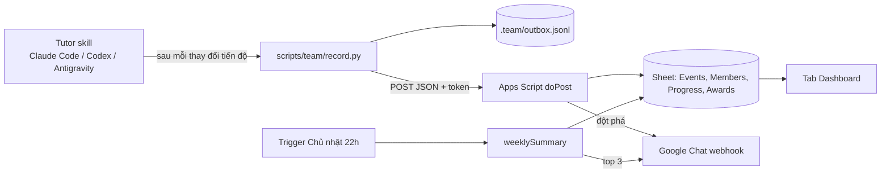
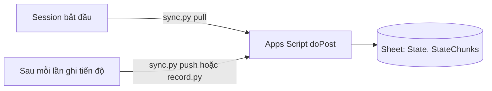

# Theo dõi tiến độ học chứng chỉ Claude cho team

Mỗi member học bằng tutor `claude-certification` trên bản clone của mình. Sau mỗi thay đổi tiến độ, tutor gọi `scripts/team/record.py`. Script gửi một event lên Apps Script web app. Web app ghi vào Google Sheet, gửi lời khen "đột phá" lên Google Chat, và tổng kết tuần vào tối Chủ nhật. Hệ thống chỉ khen, không nhắc nhở.



Bản clone chưa tham gia team vẫn học bình thường: `record.py` in một dòng rồi thoát 0.

Member học trên nhiều máy thì `scripts/team/sync.py` đồng bộ `CLAUDE-CERTIFICATION.md` và `learning-artifacts/` qua cùng web app. Snapshot được mã hoá trên máy member trước khi gửi.



## Hướng dẫn

- [Dành cho member](MEMBER.md): tham gia team, học với tutor, bật/tắt chia sẻ điểm.
- [Dành cho admin](ADMIN.md): dựng Sheet và Apps Script, mời member, quy tắc khen, tổng kết tuần, xử lý sự cố.

## Giao thức

Event gửi lên web app bằng `POST` JSON:

```json
{
  "v": 1,
  "id": "1b9d6bcd-bbfd-4b2d-9b5d-ab8dfbbd4bed",
  "ts": "2026-11-02T21:15:04+07:00",
  "token": "<TEAM_TOKEN>",
  "email": "an.nguyen@vti.com.vn",
  "type": "lesson_completed",
  "track": "ccdv-f",
  "route_total": 15,
  "data": {"lesson": "certifications/claude/lessons/00-certification-strategy", "quiz": "2/2"}
}
```

| `type` | `data` |
|---|---|
| `member_joined` | `{"name": "Nguyễn Văn An", "share": true}` |
| `share_changed` | `{"share": false}` |
| `track_started` | `{}` |
| `lesson_completed` | `{"lesson": "...", "quiz": "N/M"}` |
| `assessment_attempted` | `{"kind": "mock", "assessment_id": "claude-ccdv-f-mock-01", "score": 82.5, "domains": {"tools-mcps": 70}}` |

`member_joined` và `share_changed` có `track` và `route_total` là `null`. `route_total` lấy từ track JSON, nên web app không cần giữ bản sao route. Token không được lưu trong outbox. Script chỉ gắn token lúc gửi.

Web app trả về `{"ok": true}`, hoặc `{"ok": true, "duplicate": true}` khi `id` đã có. Khi lỗi, web app trả về `{"ok": false, "error": "<mã>"}`:

| Mã lỗi | Hành vi của `record.py` |
|---|---|
| `bad_token` | Giữ event, dừng gửi, nhắc lấy mã tham gia mới |
| `busy`, `server_error`, lỗi mạng | Giữ event, dừng gửi, lần sau gửi tiếp |
| `bad_json`, `bad_request`, `bad_domain` | Chuyển event sang `.team/rejected.jsonl`, gửi tiếp event sau |

### Đồng bộ nhiều máy

Yêu cầu đồng bộ cũng là `POST` JSON, phân biệt với event bằng trường `action`:

```json
{
  "action": "state_push",
  "token": "<TEAM_TOKEN>",
  "email": "an.nguyen@vti.com.vn",
  "auth": "<64 ký tự hex = HMAC-SHA256(sync_key, \"auth\")>",
  "base_rev": 3,
  "blob": "<snapshot đã mã hoá, base64url>"
}
```

| `action` | Trường thêm | Trả về khi `ok` |
|---|---|---|
| `state_claim` | | `{"rev": N}`. Lần đầu tạo dòng `State` với `rev: 0` |
| `state_pull` | `rev`: revision máy đang có, hoặc `null` | `{"rev": N, "blob": "..."}`, hoặc `{"rev": N, "unchanged": true}` |
| `state_push` | `base_rev`, `blob` (≤1.400.000 ký tự) | `{"rev": N + 1}` |
| `state_mail` | `code`: lệnh thêm máy (≤4.000 ký tự) | `{"mailed": true}`. Gửi tới chính `email`, không lưu `code` |

| Mã lỗi | Ý nghĩa | Hành vi của `sync.py` |
|---|---|---|
| `claimed` | Email đã đăng ký bằng khoá khác | Hướng dẫn dùng `setup.py --export-device` |
| `not_found` | Admin đã xoá dòng `State` | Đăng ký lại rồi đẩy bản local |
| `bad_sync_key` | Khoá không khớp | Cảnh báo, bỏ qua |
| `stale` | Máy khác vừa đẩy bản mới | Tải về rồi gộp |
| `mail_limited` | Đã gửi mail trong 10 phút gần đây | Cảnh báo, đợi rồi thử lại |
| `mail_failed` | `MailApp` từ chối gửi | Cảnh báo, gợi ý `setup.py --export-device` |

Server chỉ lưu `sha256:<hex>` của `auth`, không lưu `auth`. Snapshot là tar.gz của các file đồng bộ, mã hoá bằng keystream HMAC-SHA256 theo counter, kèm thẻ HMAC-SHA256 trên ciphertext (`scripts/team/_vault.py`). Snapshot lớn hơn 1MB sau nén thì bỏ các artifact lớn nhất trước. File tiến độ luôn được giữ.

Trên máy member:

| File | Nội dung |
|---|---|
| `.team/config.json` | Thêm `sync_key`, `sync_claimed`, và `device_mailed` (đã gửi mail lệnh thêm máy chưa) |
| `.team/sync.json` | Revision và dấu vân tay của lần đồng bộ gần nhất, cờ chờ gộp |
| `.team/remote/` | Bản của máy khác cho các file hai máy cùng sửa |
| `.team/backup/` | Bản local trước khi bị thay, giữ 5 bản gần nhất |

## Kiểm thử

```bash
python3 -m unittest discover -s scripts/team/tests -v
node --test team/apps-script/test_*.js
```

`test_logic.js` kiểm tra các hàm thuần trong `Logic.gs`. `test_code.js` chạy `Code.gs` với Sheet, Chat, Properties và Lock giả, để bắt lỗi trước khi deploy.
