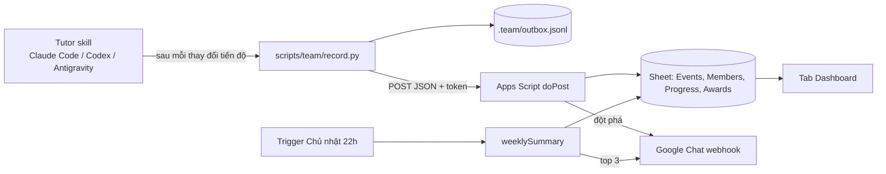

# Theo dõi tiến độ học chứng chỉ Claude cho team

Mỗi member học bằng tutor `claude-certification` trên bản clone của mình. Sau mỗi thay đổi tiến độ, tutor gọi `scripts/team/record.py`. Script gửi một event lên Apps Script web app. Web app ghi vào Google Sheet, gửi lời khen "đột phá" lên Google Chat, và tổng kết tuần vào tối Chủ nhật. Hệ thống chỉ khen, không nhắc nhở.



Bản clone chưa tham gia team vẫn học bình thường: `record.py` in một dòng rồi thoát 0.

## Hướng dẫn

- [Dành cho member](MEMBER.md): tham gia team, học với tutor, bật/tắt chia sẻ điểm.
- [Dành cho admin](ADMIN.md): dựng Sheet và Apps Script, mời member, quy tắc khen, tổng kết tuần, xử lý sự cố.

## Giao thức

Event gửi lên web app bằng `POST` JSON:

```json
{
  "v": 1,
  "id": "1b9d6bcd-bbfd-4b2d-9b5d-ab8dfbbd4bed",
  "ts": "2026-11-02T21:15:04+07:00",
  "token": "<TEAM_TOKEN>",
  "email": "an.nguyen@vti.com.vn",
  "type": "lesson_completed",
  "track": "ccdv-f",
  "route_total": 15,
  "data": {"lesson": "certifications/claude/lessons/00-certification-strategy", "quiz": "2/2"}
}
```

| `type` | `data` |
|---|---|
| `member_joined` | `{"name": "Nguyễn Văn An", "share": true}` |
| `share_changed` | `{"share": false}` |
| `track_started` | `{}` |
| `lesson_completed` | `{"lesson": "...", "quiz": "N/M"}` |
| `assessment_attempted` | `{"kind": "mock", "assessment_id": "claude-ccdv-f-mock-01", "score": 82.5, "domains": {"tools-mcps": 70}}` |

`member_joined` và `share_changed` có `track` và `route_total` là `null`. `route_total` lấy từ track JSON, nên web app không cần giữ bản sao route. Token không được lưu trong outbox. Script chỉ gắn token lúc gửi.

Web app trả về `{"ok": true}`, hoặc `{"ok": true, "duplicate": true}` khi `id` đã có. Khi lỗi, web app trả về `{"ok": false, "error": "<mã>"}`:

| Mã lỗi | Hành vi của `record.py` |
|---|---|
| `bad_token` | Giữ event, dừng gửi, nhắc lấy mã tham gia mới |
| `busy`, `server_error`, lỗi mạng | Giữ event, dừng gửi, lần sau gửi tiếp |
| `bad_json`, `bad_request`, `bad_domain` | Chuyển event sang `.team/rejected.jsonl`, gửi tiếp event sau |

## Kiểm thử

```bash
python3 -m unittest discover -s scripts/team/tests -v
node --test team/apps-script/test_*.js
```

`test_logic.js` kiểm tra các hàm thuần trong `Logic.gs`. `test_code.js` chạy `Code.gs` với Sheet, Chat, Properties và Lock giả, để bắt lỗi trước khi deploy.
